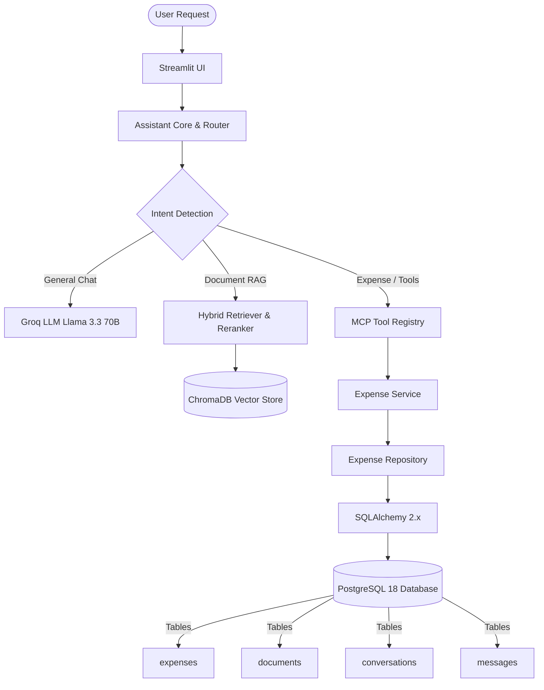
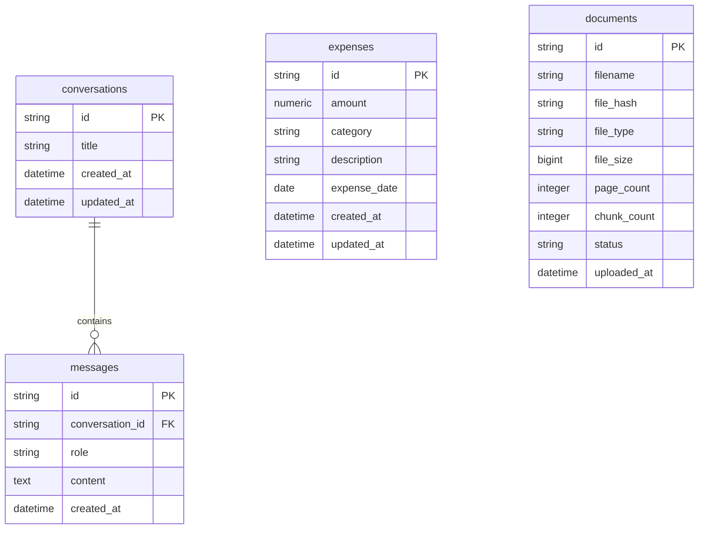

# Architectural Specification — AI Knowledge Assistant (PostgreSQL + RAG + MCP)

## Overview

The **AI Knowledge Assistant** is a production-grade, hybrid database AI system incorporating:
- **PostgreSQL 18**: Relational persistence for expenses, document metadata, conversations, and messages using SQLAlchemy 2.x, Psycopg 3, and Alembic migrations.
- **ChromaDB**: Persistent vector database storing 384-dimensional dense embeddings (`all-MiniLM-L6-v2`) for semantic search and document RAG.
- **MCP Subsystem**: Model Context Protocol tool registry executing local tools (`add_expense`, `list_expenses`, `summarize_expenses`, `get_stock_price`, `duckduckgo_search`).
- **Structured Output Pipeline**: Pydantic validation & relative date resolution for natural language inputs.

---

## Architectural Diagram

---

## Database ERD (Entity Relationship Diagram)

